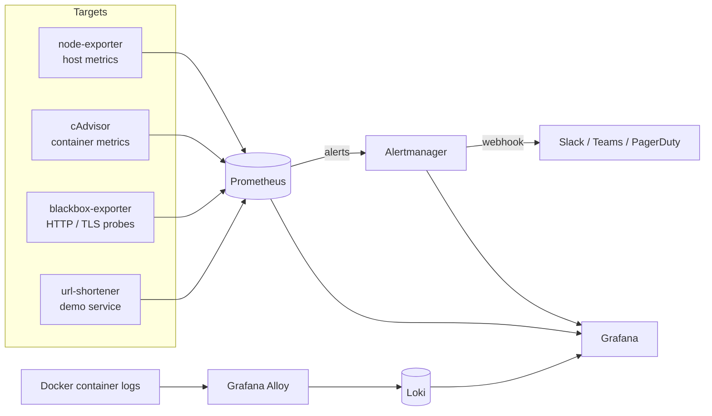

# observability-stack

[](https://github.com/shivanjalikaname/observability-stack/actions/workflows/validate.yml)

A complete, opinionated monitoring stack you can start with one command: metrics, logs,
dashboards, synthetic checks and alerting, with alert rules that are unit-tested in CI.

It's the setup I reach for when a team needs real observability on a single host or a
small environment, and the starting point I'd adapt before moving to Kubernetes.

## Architecture



## Quick start

```bash
cp .env.example .env          # set GRAFANA_ADMIN_PASSWORD
make up                       # core stack
make demo                     # optional: add a sample service with live traffic
```

Then open Grafana at http://localhost:3000. The **Host overview** dashboard is the home page;
**Service RED metrics** shows the demo service once `make demo` is running.

| Component | URL | Purpose |
|-----------|-----|---------|
| Grafana | http://localhost:3000 | Dashboards, log search (Explore → Loki) |
| Prometheus | http://localhost:9090 | Metrics, targets, rule status |
| Alertmanager | http://localhost:9093 | Active alerts, silences |
| Loki | http://localhost:3100 | Log storage (used via Grafana) |
| Alloy | http://localhost:12345 | Log pipeline UI and debugging |
| Demo service | http://localhost:8000/docs | Sample API (`demo` profile only) |

## Alerts

| Alert | Severity | Fires when |
|-------|----------|------------|
| InstanceDown | critical | A required scrape target is unreachable for 2m |
| EndpointDown | critical | A synthetic HTTP check fails for 3m |
| TLSCertificateExpiringSoon | warning | A probed certificate expires in under 14 days |
| HighCPUUsage | warning | Host CPU > 90% for 10m |
| HighMemoryUsage | warning | Host memory > 90% for 5m |
| DiskWillFillIn4Hours | critical | Linear trend says a filesystem fills within 4h *and* it's under 25% free |
| ContainerOOMKilled | warning | A container was OOM-killed in the last 10m |
| HighHTTP5xxRate | critical | Over 5% of a service's requests are 5xx for 5m |
| HighLatencyP95 | warning | Service p95 latency > 500ms for 10m |

Every alert carries a `runbook_url` pointing at [docs/runbooks.md](docs/runbooks.md).

**Routing** ([alertmanager/alertmanager.yml](alertmanager/alertmanager.yml)): critical alerts go to the
`oncall` receiver with a faster first notification and hourly repeats; warnings go to `default`.
Inhibition rules suppress warnings on an instance that already has a critical alert, and
suppress `EndpointDown` when `InstanceDown` already explains it. Point the two webhook URLs at
your chat or paging integration.

## Adding a scrape target

1. Add a job to [prometheus/prometheus.yml](prometheus/prometheus.yml):
   ```yaml
   - job_name: my-api
     static_configs:
       - targets: [my-api:8080]
   ```
   If the service exposes `http_requests_total` and `http_request_duration_seconds`, it automatically
   appears in the RED dashboard and is covered by the 5xx and latency alerts.
2. Add a synthetic check by appending its URL under the `blackbox-http` job.
3. `make reload` — no restart needed.

## Validation

CI ([.github/workflows/validate.yml](.github/workflows/validate.yml)) runs on every push:

- `yamllint --strict` across the repo
- `promtool check config` and `promtool check rules`
- `promtool test rules` — unit tests for alert behaviour in [tests/alerts_test.yml](tests/alerts_test.yml)
  (fires when it should, stays quiet when it shouldn't, and the annotations render correctly)
- `amtool check-config`, Loki `-verify-config`, `alloy fmt`
- dashboard JSON validity and unique UIDs
- `docker compose config` for both profiles

Run the same checks locally with `make validate`.

## Design notes

- **Recording rules first.** Dashboards and alerts read pre-computed series
  (`instance:node_cpu_utilisation:ratio`, `service:http_errors_5xx:ratio_rate5m`, ...), so panels
  load fast and alerts and dashboards can't disagree about what "error rate" means.
- **Alerts on symptoms, with guards.** `DiskWillFillIn4Hours` needs both a bad trend *and* low free
  space, which removes the classic false positive of a temporary file filling an empty disk.
  `HighHTTP5xxRate` ignores services with negligible traffic, where one error is 100%.
- **Optional targets.** Jobs labelled `optional="true"` (the demo service) are excluded from
  `InstanceDown`, so the core stack runs clean without the demo profile.
- **Pinned versions.** Every image is pinned; upgrades are deliberate and go through CI.
- **Bounded resources.** Each container has CPU and memory limits and capped log files, so the
  monitoring stack can't become the thing that takes the host down.
- **Alloy over Promtail.** Promtail is end-of-life; Alloy discovers containers through the Docker
  API and attaches compose service and project labels to every log line.

## Repository layout

```
docker-compose.yml        Stack definition (core + optional demo profile)
prometheus/               Scrape config, recording rules, alert rules
alertmanager/             Routing, grouping, inhibition
grafana/                  Provisioned datasources and dashboards
loki/  alloy/             Log storage and collection
blackbox/                 Synthetic probe modules
tests/                    promtool unit tests for alerts
docs/runbooks.md          What to do when each alert fires
```

## License

[MIT](LICENSE)
